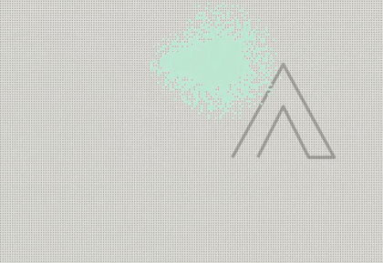
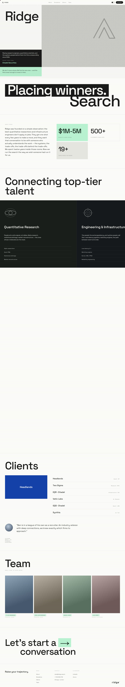
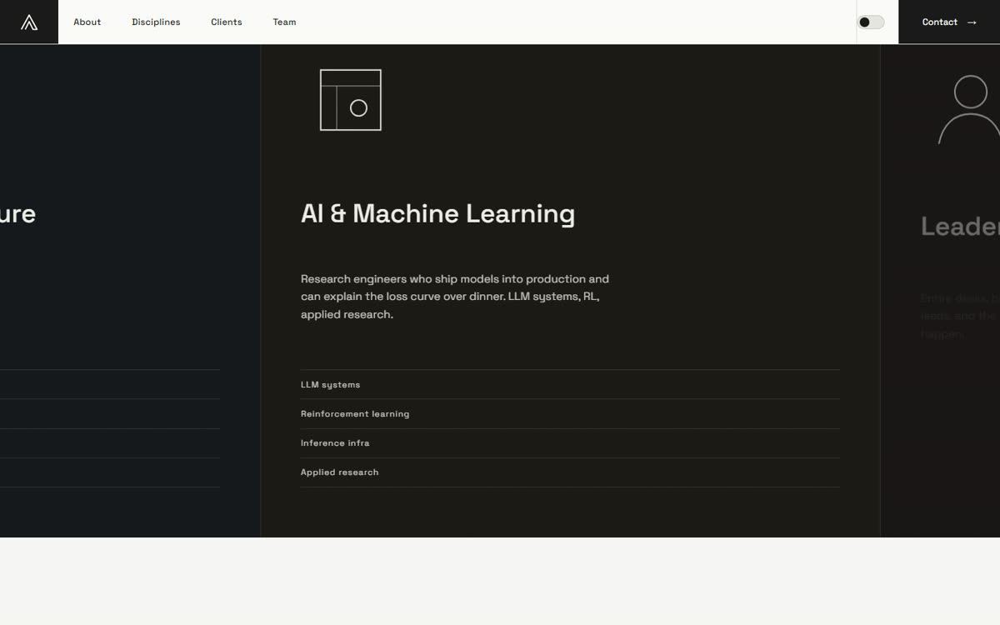
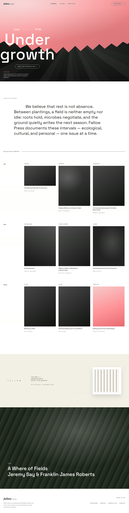
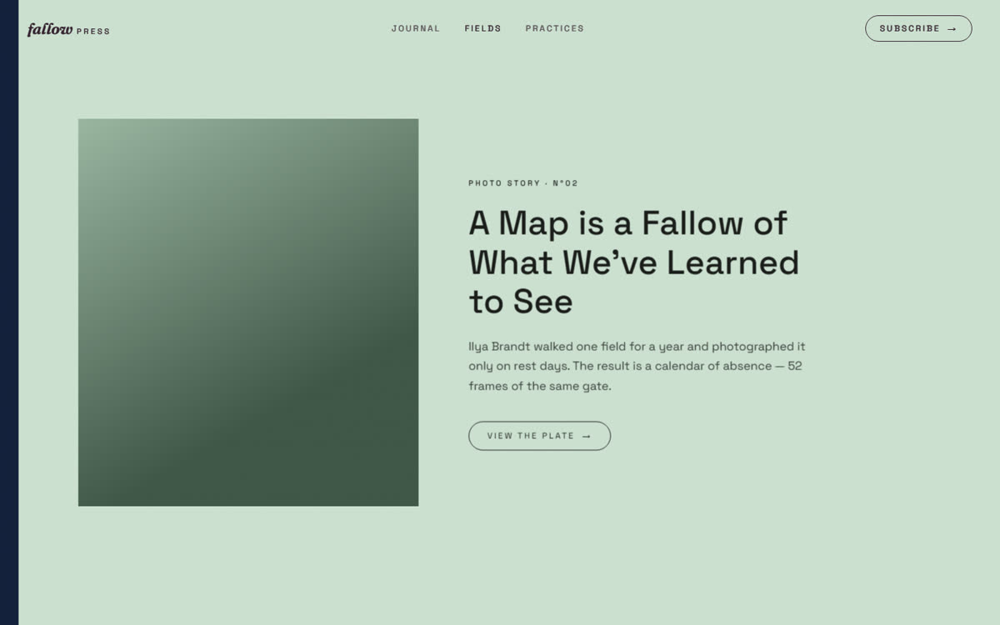
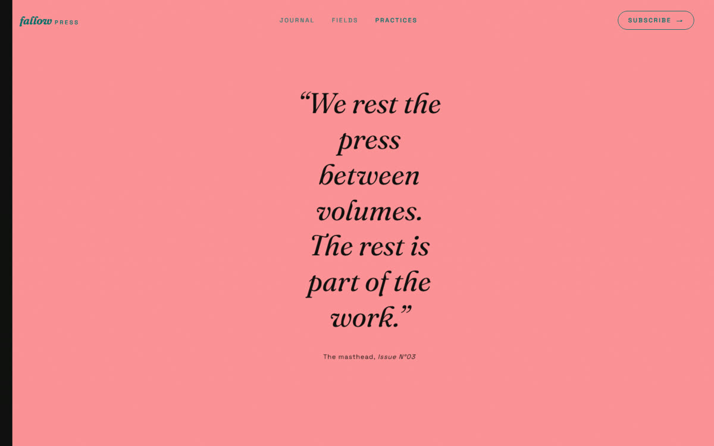
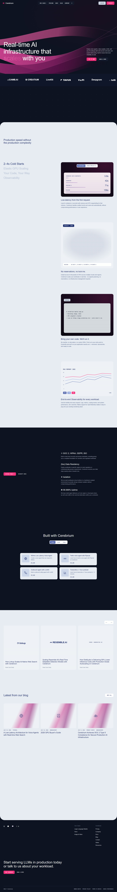
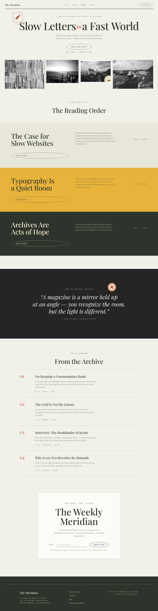
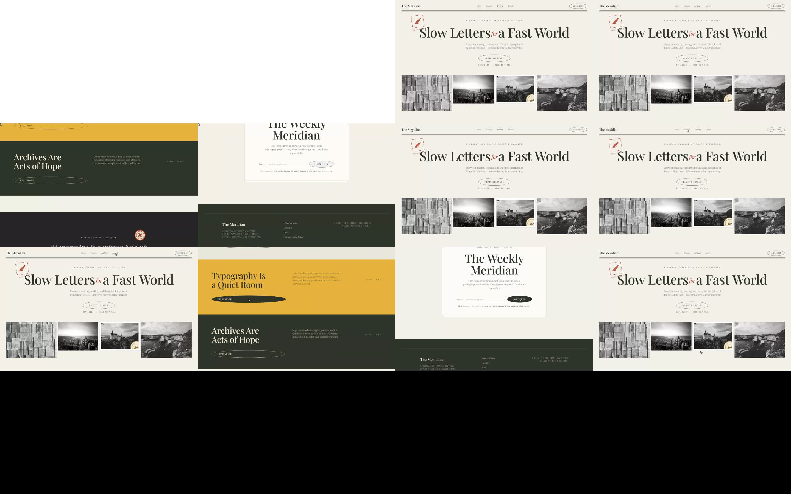

#  awwwards-mcp

Free, open-source MCP server that gives AI agents design inspiration from
[Awwwards](https://www.awwwards.com/) — the Mobbin-style visual reference loop,
sourced from the web's best award-winning websites.

[](https://m8ven.ai/mcp/insane0777-awwwards-mcp-1ll2az?s=readme) [](https://mcp.market/server/insane0777-awwwards-mcp) [](https://awwwards-mcp.vercel.app) [](https://github.com/sponsors/INSANE0777)

Project site: **https://awwwards-mcp.vercel.app**

<p align="center">
  <picture>
    <source media="(prefers-color-scheme: dark)" srcset="assets/White%20awwwards-mcp%20logo%20on%20transparent.png">
    
  </picture>
</p>

<a href="https://github.com/INSANE0777/Awwwards-mcp"></a>

Your agent searches in natural language ("dark 3D portfolio sites", "soft pastel
e-commerce"), sees **real screenshots inline**, and pulls the **design DNA** of any
site: color palette, tech stack, design elements, award history. Then it goes past
inspiration: point it at **any link** and it band-maps the page, censuses scroll and
hover motion (keyframes, measured scrub curves), fingerprints the framework, captures
canvas pose grids, and reads the site's bundles when a mechanism is unclear. From that
evidence it **recreates the page section by section**, then converts the build into a
runnable **Vite, Astro or Next.js project** with a measured motion manifest and
per-section hooks. Close the loop with **`verify_build`** (band + motion scoring,
measured perf) and generate GSAP timelines from the captured motion.

And it's not just Awwwards websites — every capture, census, and verification
tool **runs on any URL**. Just give it any site link and tell it to recreate:
band-map it, study its motion, rebuild section by section, and score your
build against the original.

Free-text queries run on a porter-stemmed, prefix-matching FTS5 index with BM25
ranking — "magazines" now finds Magazine-tagged sites (68 on the live index),
best matches first, where the old substring path returned zero. Multi-word
queries keep AND semantics: every token must hit the same site.

## Tools

| Tool | What it does |
|------|--------------|
| `search_sites` | Search by color, tags, technology, award type or free-text query; e.g. `award: "soty"`, `award: "nominees"`, `award: "ecommerce"` (winners), or a technology alias like `technology: "nextjs"` which canonicalizes to the live slug. Multi-word queries match against the local FTS5 index and rank BM25 (title hits lead); zero results come with loose-match and taxonomy-tag hints. Default full results include each site's screenshot; use `responseMode: "compact"` for concise cards and inline previews of only the first two results on the requested page. |
| `get_site_details` | Design DNA for one site: palette, technologies, elements, awards, description. Batch (`slugs`, up to 10) is compact enrichment for a shortlist — `compactSiteDetails` per slug (lists as counts, ≤500-char description, awards), cached/fetched/error status, no inline images. |
| `compare_sites` | Compare 2–3 sites' design DNA and jury scores as text-only JSON. Uses cached details or fetches missing detail pages. |
| `create_design_brief` | Turn 2–5 selected site slugs plus a required project goal into a deterministic, cited build brief. Uses cached detail/element evidence and cached Motion DNA first, fetches only missing details, returns Markdown plus versioned JSON, and runs browser band analysis only with `includeStructure: true`. |
| `get_index_status` | Read local index count, crawl progress, last success/error, lock state and freshness without network requests. |
| `get_index_stats` | Aggregate metrics over the **local cache only** (zero network). **All-time:** site count, gallery element count (`elements.total`) and technology/tag frequency (`items[].tag`); `elements.corpus` discloses the whole locally cached element set — total, gallery, site, categorized/uncategorized, builtWithKnown and oldest/newest fetch timestamps (aggregates only, no titles or slugs). **Windowed** by `windowDays` (default 90, 1–3650): cached details, palette colour frequency and jury score stats (n/avg/median) from at most the 500 most recently fetched detail rows, plus Motion DNA library frequency. Coverage is labelled `"locally cached subset"` on every metric; `windowDays`/`detailsCached`/`detailParseCap` appear only on the windowed metrics, while sites/elements/technologies are explicitly all-time. `top` caps each frequency list (default 10, 1–50). Aggregates only — no site slugs or titles. Personal, non-commercial use. |
| `get_site_elements` | Component-level visuals for one site: each element's poster image inline (3D models, video content, mobile layouts, microcopy…) + video URLs. |
| `list_categories` | Every filter the agent can search by (200+ tags, 27 colors). A legacy cache without technology facets is refreshed on read; if that refresh fails the response sets `taxonomyStale: true` with a `taxonomyWarning`. |
| `get_collections` | Browse Awwwards' curated and member collections. No slug lists collections (paginated, ~32 per page, `owner`/`ref` on every row); a slug returns one page of that collection's site cards (curated e.g. `brutalism`, or `owner/slug` for member collections; `page` works for collections too). Results expose `siteCards` separately from `items` (all collectables), so element-only collections return empty sites rather than a parser error. 7-day local cache. Personal, non-commercial inspiration use. |
| `search_directory` | Browse the Awwwards directory of agencies, studios and freelancers: name, profile slug, location, website and award counts. Filters are path-based (`country`, `category`, `budget`; one per request — e.g. budget `over_hundred_thousand`). Country must be canonical and case-sensitive (`United States`, not `united states`). Results carry `applied`/`ignored` filter arrays; free-text `query` is matched client-side over the one fetched page. Contact details are stripped. 7-day local cache. Personal, non-commercial inspiration use. |
| `get_annual_categories` | Official Annual Awards categories (Site of the Year, Agency of the Year, …) with nominee counts from Awwwards' public read-only API. Nominee details hydrate on request. Personal, non-commercial inspiration use; media URLs are reference-only. |
| `get_annual_nominees` | Nominees in one Annual Awards category, hydrated on demand at 1 request/second (default 10, max 20). Site summaries include `siteSlug` and `inLocalIndex` so agents can jump to `get_site_details` when the daily index has the site. |
| `get_annual_nominee` | One Annual Awards nominee in full — site: date, description, designBy, country, images/videos; agency: location, avatar, award tag counts, featured projects. Accepts a UUID, a full `/api/annual/nominees/...` path, or category+slug; the slug form may hydrate up to 20 uncached nominees at 1 req/s (~20s worst case), so prefer an id when known. Media URLs are reference-only (`mediaNote: "reference-only"`); nothing is downloaded. |
| `capture_live_site` | Optional: fresh full-page screenshot of any live URL. Waits for `load` + a settle window with a pre-scroll capped at 80 × 450px steps / 8 s (step- and time-capped so a growing page cannot stall it), so heavy sites work (`waitStrategy: "networkidle"` available). After the scroll it waits up to 10 s for a full-screen fixed preloader (≥90% viewport, z-index ≥100) to clear, so the site — not its loader — is captured; `waitForOverlay: false` skips that wait. Pass `viewport: "mobile"` for the 390×844 iPhone-class render (`"desktop"` 1440×900 default). On inner-scroller pages (`body` pinned, an inner container scrolls) it returns `mode: "anchors"` — six ordered viewport screenshots down that container as JSON `anchors[].scrollTop`/`file` paths, with no inline image and no top-level `file`; `scrollCapture: "viewport"` forces one explicit viewport shot instead. Document-scrolling pages keep the single full-page capture. Inline previews are capped at 2.5 MB of base64; `inline: false` keeps only the saved file. (needs [playwright](https://playwright.dev)). |
| `analyze_page_structure` | Section band map of any page (live URL or local file:// build): tag, background, offset, height per band. Detects the real scroll container when the page pins `body` and scrolls an inner element (`overflow-y: auto/scroll`), reports it as `scrollRoot` (`tag#id.class`), and measures every band and landmark in that scroller's coordinates; the pre-scroll drives the same container. Compare a reference site's structure against your build. Same heavy-site-friendly wait (`waitStrategy: "networkidle"` available); `viewport: "mobile"` analyzes the phone-class layout (`"desktop"` default). `compare: "mobile"` adds a second 390×844 capture and returns `mobileBands` + `diff: {heightDelta, bandsAdded, bandsRemoved, reordered}` (label-matched); if the mobile capture fails you still get the desktop result plus `mobileError`. Absent, the response is unchanged. `cdpEndpoint` instead attaches to a browser you started (loopback only, requires `AWWWARDS_MCP_ATTACH=1`) and scans the already-open matching page — it never navigates, scrolls, clicks or creates tabs, and disconnects without closing yours. (needs [playwright](https://playwright.dev)). |
| `record_site_motion` | Optional: short motion-through video of a live URL — preloader, scroll-triggered and hover/cursor animations. Returns an inline filmstrip JPEG plus the saved .webm path. `viewport: "mobile"` records at phone size — the filmstrip renders at the selected viewport, no pillarboxing (`"desktop"` default). Every recording also produces a **Motion Evidence Sheet** (`sheet.html` + `motion-sheet.md`): census-directed keyframes, consecutive-frame diff masks, an onion-skin composite, a cursor-trail overlay and a phase timeline — motion video turned into a document a model can actually read. Degrades gracefully: recording never fails because the sheet does. (needs [playwright](https://playwright.dev) + ffmpeg-static). |
| `search_elements` | Search the element corpus (footer, hero, pricing, 404…) by free text: cached `source:"gallery"` records plus `source:"site"` records backfilled from new winners' own Elements sections; ranks BM25 over title/author/category. `category` (exact) and `stack` (case-insensitive substring, all terms AND) are applied across the whole cached corpus before the limit. It does **not** crawl the robots-disallowed `/elements/*` gallery. |
| `get_element` | One element record: title, category, author, built-with stack, related elements and its media URL (image or video) pointing at awwwards' CDN. |
| `get_motion_dna` | Runtime motion fingerprint of a live URL: animation libraries, render engines, ScrollTrigger stats (trigger count, scrub ratio), tween easing/duration vocab and the scroll model. Fresh capture or cached capture with timestamp. |
| `analyze_scroll_map` | Per-element scroll-motion census of any URL: selector path, trigger source (gsap-scrolltrigger / native css scroll & view timelines / data-attr / css-keyframe / SMIL), animated props, duration, easing, scrub/pin flags and SVG stroke draw-ins — the rebuild recipe an agent can wire straight into GSAP timelines. Optional `scrubProbe` re-drives the page through ≤8 scroll steps and samples each scrubbed trigger's real progress curve (`scrubCurves`); every payload ends with a `choreography` block — `hints[]` (selector/value/source) and `groups` read from `gsapTriggers` tween vars and stepped sibling `delayMs`. (needs [playwright](https://playwright.dev)). |
| `analyze_hover_census` | Hover-interaction census: extracts `:hover` rules from stylesheets, then samples up to 20 interactive elements before/after hover — transform/color/filter diffs plus transition timing (ms + easing). The hover recipe for rebuilds, no video required. (needs [playwright](https://playwright.dev)). |
| `analyze_bundle` | Bundle forensics for a live page: fetches the page once, downloads its script chunks (script tags, inline scripts, and modulepreload/preload-as-script hints; bounded: ≤40 chunks / 10MB / 1 request/second), saves + hashes them locally, optionally de-obfuscates with webcrack if installed, and greps keywords across the code — chunk paths + match lines so an agent can read the actual animation mechanism instead of guessing. Optional `edges` adds the static import graph over the captured chunks (import/reexport declarations up to 8 KB each). Needs no browser. |
| `analyze_network_capture` | Offline API-surface evidence from a local HAR 1.2 file (a browser DevTools export): requests grouped by method + origin + path template (dates, versions, UUIDs, hex ids and numbers templated; emails, tokens and long high-entropy segments redacted), with counts, statuses, content types and query names only. Reads the file only - never fetches recorded URLs and never returns bodies, headers or query values. 20 MB / 2000-entry caps; `evidenceCoverage` discloses what was excluded. No network. |
| `audit_url` | Runtime + static performance **evidence** for any live URL — never a grade. Runtime: installed Chrome/Edge over raw CDP (no playwright) measures fps, dropped frames, long tasks/animations and layout thrash (`perf: {error}` when no browser exists). Static: fetches the page HTML + up to 8 same-origin CSS/JS assets (≤2MB each, one shared 1 req/s limiter, 10s default timeouts), resolving refs against the final post-redirect page URL; asset redirects leaving that origin are rejected. Scans them for animation anti-patterns and returns severity-sorted findings (`count`, `worst`, ≤50 `findings`, `coverage: {assetsScanned, failed}`) so `worst` is always included. Each half degrades independently. Personal, non-commercial use; audit only URLs you are authorised to inspect. |
| `analyze_accessibility` | Accessibility **evidence** from a live page — explicitly not a WCAG pass/fail. Samples up to `limit` (default 100, max 200) visible text nodes with computed colour and a background **composited bottom-up from the ancestor stack** for fully opaque chains (colour alpha layers; reported as final `rgb()`), then the contrast ratio (worst pairs + selector paths). A sample under any ancestor CSS opacity group (<1) is **excluded from ratios** and counted in `coverage.skippedOpacityGroups` — never approximated. Background images, gradients and pseudo-elements are not composited either, so contrast stays heuristic there. Also: image alt coverage; heading ladder issues; focusable/positive-tabindex counts plus `outline:none` stylesheet rules; unlabeled form controls; document `lang`/title. Returns `coverage`, `heuristic: true` and the note "Evidence only — not a WCAG pass/fail". Accepts http(s) URLs only; degrades to `{error}` when playwright is missing. (needs [playwright](https://playwright.dev)). |
| `build_project` | Convert a single-file exact rebuild (any local `.html`, e.g. the rebuild flow's `full-page-exact.html`) into a runnable **Vite**, **Astro** or **Next.js** project: sections become components, CSS splits per section, gsap timelines re-wire in the framework idiom (`useEffect` + `gsap.context` on Next), assets carried. Reads a local file and writes the project dir — the suite's one local-write tool. |
| `verify_build` | Score a build against a reference site: band-map compare (Dice score) + motion-fingerprint diff (trigger mix, scrub/pin, easing vocabulary, native scroll timelines) → 0–100 score, pass/warn/fail verdict and evidence lines. `bands` carries one aggregate score plus `matched`/`refOnly`/`buildOnly` labels and a `diagnostics` row per band (reference/build index, match reason, relative-order flag, height delta, background change) — there are no per-band scores. The design-loop gate: build → verify the aggregate band score → fix → re-verify. Optional `domDiff` adds a body-subtree structural diff (missing/extra/reordered/rect drift) between reference and build. Optional `scene3d` adds a separate, opt-in 3D gate that preflights both URLs through one shared DNS/private-IP guard before any legacy scan (a private or loopback URL is refused with no requests, and the legacy acquisitions run behind the same proxy), then replays a `capture_scene_3d` pack on the build canvas and returns its own status/verdict; the legacy verdict never certifies a canvas (see [Opt-in 3D verify gate](#opt-in-3d-verify-gate)). (needs [playwright](https://playwright.dev)). |
| `verify_flow` | Step-aligned interaction-flow comparison: runs the same 1–6 scroll/click/wait steps on a build and a reference URL (two fresh headless launches, desktop or mobile) and compares path, scroll delta, skeleton hash, text hash and element count after each step. `same` only when both sides are complete and untruncated — truncated or failed states are `unknown`. No screenshots; a click can still trigger client-side mutations. (needs [playwright](https://playwright.dev)). |
| `capture_component` | Optional: serialize one page component (CSS selector, default `header`) into a portable `component-pack-v1` JSON pack — bounded DOM tree with computed-style tokens (44 keys incl. layout offsets + `::before`/::after pseudo styles, `maxNodes` up to 2000, optional `maxDepth` where values above 12 can exceed Code Mode's depth cap and 12 keeps a capped pack safe), fonts, colors and element animations — for pixel-informed rebuilds. Adds `typography` usage summaries (families/sizes/weights/line-heights/letter-spacings, top 12 each, `sampled` node count) and a deduped `paletteSummary` (colour counts from node styles + pack colors, transparent/rgba(0,0,0,0)/none filtered, top 24). `compact: true` trades detail for tokens: each node keeps only `{tag, classes, rect}` (styles, text, svg, pseudo styles and anims are dropped) plus top-level `fonts`/`colors`; the `typography`/`paletteSummary` summaries are full-mode only. Runs on any URL. (needs [playwright](https://playwright.dev)). |
| `export_design_tokens` | Deterministic design-token export from one computed-style capture: colors, typography, spacing, radii, shadows and borders as ordinal CSS variables (`--color-1`, `--space-1`, …) plus a Tailwind theme map. `selector` defaults to `body`, `maxNodes` to 800 (50–2000); `include` filters categories. Names are ordinals — never semantic guesses — values are deduped, frequency-ranked and capped; a category cap or node truncation sets `truncated` and names the reason in `notes`, and the CSS contains no URLs. Runs on any URL. (needs [playwright](https://playwright.dev)). |
| `analyze_images` | Image-delivery **evidence** for a live page: totals by format, `loading` split (lazy/eager/missing), `srcset`/`sizes` coverage, intrinsic vs rendered dimensions (oversized, tiny, zero-rect), broken images and alt coverage; up to 20 issue samples with origin+pathname only (query/hash stripped, data URIs reduced to `data:<mime>`). The page loads its own assets — no tool-initiated fetches, no downloads. `maxImages` defaults to 200 (max 500); `truncated` when the pre-cap total is larger. Not a WCAG grade. (needs [playwright](https://playwright.dev)). |
| `capture_pose_3d` | Hero canvas reference frames → `pose-grid-v1`; runs on any URL. Samples the page's largest canvas at up to 10 scroll steps with per-step scroll ratios (`viewport: "mobile"` supported). Frame evidence only — camera transforms are not recovered. (needs [playwright](https://playwright.dev)). |
| `capture_scene_3d` | Two strict ops. `op:"capture"` writes a `scene-evidence-v1` pack for a WebGL/canvas page: up to 10 checkpoints (scroll ratio + optional normalized pointer + settle wait), each saving a viewport screenshot and a clipped canvas screenshot (the chosen canvas gets a per-run random marker; duplicate or pre-marked decoys are refused) with requested/actual scroll, scroll range, canvas CSS rect/backing size/DPR and elapsed ms plus a post-screenshot `stable`/`stabilityReason` flag; plus passive framework hints and a redacted inventory of up to 200 of the page's own responses (origin+pathname only, MIME, Content-Length when declared, resource type, texture/model/HDR/shader/script/font/image classification, plus an `assetId` and download status per row). The internal download URL is stored only when the observed URL has no query, fragment or credentials; every other row carries a skip reason. Without adapters, no hooks and no `getContext` are used during capture; the spector adapter injects its own WebGL bundle before load. `op:"download_assets"` fetches up to 32 `assetId`s from one `captureId`: `rights.basis` (`owned`/`licensed`/`permission`) and `rights.evidence` are mandatory because downloading is a licensing decision, are recorded with a timestamp in `provenance.json`, and are not verified by the server. Originals are written to `<cache>/scene-captures/<captureId>/assets` with SHA-256 and an extension validated from MIME/magic (unknown types are skipped unless `allowUnknown` saves them as `.bin`). Caps: 16 MiB/file, 64 MiB/run, 5 manual redirects, 1 request/second, 15s body deadline, 120s overall; every hop is DNS-validated and loopback/private/metadata/reserved addresses are refused. It never crawls, never guesses model or source-map URLs and never uses credentials. **Honest scope:** passive capture (no adapter) recovers no scene graph, camera, controls, shader source or geometry — frames show rendered output only. Two experimental opt-in adapters extend the pack: `adapters:["three"]` adds a bounded `evidence.three` summary from reachable globals (see [Opt-in Three adapter](#opt-in-three-adapter)), and `adapters:["spector"]` captures one WebGL frame into a bounded `evidence.spector` summary with command names/counts, context attributes and capped shader source (see [Opt-in Spector adapter](#opt-in-spector-adapter)). Neither adapter crawls the heap; a requested adapter that finds nothing leaves its capabilities unknown, not available. Capture evidence is written to `<captureId>/evidence.json` + PNG frames (metadata ≤2 MiB, 8 MiB per image, 32 MiB total); responses are compact JSON with paths, hashes, counts, coverage and limitations, never inline bodies. (capture needs [playwright](https://playwright.dev)). |
| `build_pose_stub` | Pose grid → offline three.js+GSAP replay skeleton. Renders a `pose-grid-v1` grid as a standalone scroll-scrubbed stub page: frames preloaded inline (same-index loads are deduped and stale decodes discarded), a synthesized camera path interpolated between snapshot scroll ratios (guidance, not recovered camera data), reduced-motion static fallback; optional `analyze_scroll_map` census adds st/pin/ease suggestions. Pure build — no page fetches. |
| `analyze_stack` | Fingerprint any page's stack from one polite HTML fetch (no browser): framework (Next.js/Astro/Nuxt/Remix/SvelteKit/WordPress/Webflow/Framer), CSS framework (Tailwind/Bootstrap) with marker lists and honest confidence, plus a `stack-fingerprint-v1` payload. |
| `build_gsap_stub` | Captured motion evidence → runnable single-file GSAP+ScrollTrigger stub: one timeline per scroll-census anim (trigger, `start: "top 80%"`, scrub/pin, census duration, cubic-bezier easing normalized to the nearest GSAP token), plus an optional scroll-driven camera module from pose-grid anchors (synthesized dolly-in over the page's three.js canvas). Always-on `prefers-reduced-motion` guard; requires the full census shape (`anims[]` + `gsapTriggers[]`) - empty arrays still build a valid no-anim page, but a compact census is rejected. Pure build from provided JSON - no page fetches. |
| `build_motion_manifest` | Build a `motion.manifest.json` scaffold from measured evidence: an `analyze_page_structure` result (`bands`) + an `analyze_scroll_map` census, with optional `sections: [{label, selector?}]` overrides. Sections map best-effort from each band's tag plus the first `#id`/`.class` token in its label (or the override selector); no markup is available, so DOM initial-state hints are empty while census triggers still attribute by those tokens. Returns `{manifest, measured: false, censusAnims, warnings, note}` (`manifest.measured` stays false when the census has no anims/triggers/curves); never throws (`{error}` on invalid input). Pure/offline — no page fetches. |
| `build_scene_stub` | Offline Vite + Three.js scaffold from a `capture_scene_3d` pack (full profile only). Reads one `scene-evidence-v1` file (regular file ≤2 MiB, inside `scene-captures` or an exported pack with top-level `"exported": true`) and up to 32 `assetBindings` (`resourceId` → a local file you already hold: regular, non-symlink, ≤64 MiB, glb/gltf/bin/png/jpg/jpeg/webp/ktx2/hdr/exr; traversal and duplicate ids rejected). Returns `files[{path,content}]` — `package.json` with pinned `three` 0.160.0 + vite and dev/build/preview scripts, `index.html`, `src/main.js` (resize, reduced-motion static render, `GLTFLoader` for a bound model, texture loading, adapter meshes for supported Box/Plane/Sphere/Cylinder geometry with standard/basic materials, a labelled placeholder plane when no model or supported mesh exists, pagehide disposal, load-failure message), `scene.json` (bindings + frame basenames extracted from Windows or POSIX paths) and a provenance README — plus `assetCopies` to `public/assets/<assetId>.<ext>`, `unresolved`, `authoredDefaults` and `mode` (`reconstructed-subset` with a glb/gltf model or at least one supported adapter mesh, else `placeholder`). Adapter packs rebuild only the supported subset: primitive geometry, standard/basic materials and a validated perspective camera from its exact matrix (static, no idle orbit); captured controls are never recreated and are listed in `unresolved`. Unsupported geometry, materials and cameras plus missing dimensions are also listed, captured lights are recorded but not applied, and shader source/`userData` are never used. Deterministic and offline: no fetch, install, directory write or captured-code execution; copy the assets and run `npm install && npm run build` yourself. |
| `search_motion` | Search previously captured motion-DNA scans by library, scroll model or easing vocabulary — find references by how a site moves. |
| `new_winners` | Poll today's freshly-crowned winners (SOTD / Developer Award / Honorable Mention) against a persisted baseline. First call seeds the baseline and reports the current listing count (no element backfill); later calls report the delta. Each winner first reported after the baseline poll is backfilled into the searchable element corpus from its site page when reachable; failed per-winner fetches are not retried. |
| `watch_site` | Persistent watches over studios, tags or specific sites (add/list/remove). `list` matches each watch against the freshest cached listing and reports per-watch `NEW since last check` deltas — it never fetches; `new_winners`/`search_sites` keep the pool fresh. |

### Routing

| You want | Use |
|----------|-----|
| Sites matching filters or free text | `search_sites` — the site index with filters. |
| Curated inspiration boards | `get_collections` — curated moodboards, not a search index. |
| Agencies, studios or freelancers | `search_directory` — agencies/studios, not sites. |
| Annual Awards categories, nominees or one nominee | `get_annual_*` — Annual Awards only. |
| Design DNA for one site, or compact enrichment for a shortlist | `get_site_details` — one `slug`, or a bounded batch of `slugs`. |
| Performance evidence for one URL | `audit_url` — one URL, no reference. |
| A scored build-vs-reference comparison | `verify_build` — two URLs, scored comparison. |
| Accessibility evidence for a live page | `analyze_accessibility` — evidence census, not compliance. |
| Section bands and desktop↔mobile changes | `analyze_page_structure` — band map and responsive comparison, not a score. |
| API calls a page makes | `analyze_network_capture` — offline HAR evidence, not a live network tool. |
| Did my build keep an interaction flow? | `verify_flow` — step-aligned state comparison, not a visual score. |

`compact:true` is the summary mode for heavy tools — `audit_url`,
`verify_build`, `analyze_scroll_map`, `analyze_hover_census` and
`capture_component` return a summary payload with less detail, and each shape
differs: the scroll/hover censuses reduce to counts, `capture_component` drops
per-node styles/text/svg/anims (the tag/classes/rect tree, fonts and colors
stay; typography/palette summaries are full-mode only), and `verify_build`
keeps `verdict`,
`overall`, `bands` and `motion` top-level while dropping `buildUrl`,
`referenceUrl` and `evidence` (`bands` holds counts); a requested `scene3d`
block is kept whole because it carries its own verdict. `audit_url` keeps its
top-level keys but reduces `perf` and `antiPatterns`.
Batch detail is `get_site_details { slugs }`, capped at 10: results stay in
input order, carry compact details only (no images), and report per-slug
`cached`/`fetched`/`error`/`skipped` status. `analyze_page_structure` with
`compare: "mobile"` returns responsive evidence alongside `mobileBands`/`diff`
— page overflow, small text and small tap targets at 390×844 — evidence, not a
score.

Passive `capture_scene_3d` capture and `op:"download_assets"` are stable
features. The Three.js and Spector adapters and the `verify_build.scene3d`
gate remain experimental and opt-in.

### Opt-in Three adapter

`capture_scene_3d` can add an experimental, opt-in Three.js adapter to an
`op:"capture"` request:

```json
{ "request": { "op": "capture", "url": "https://example.com", "adapters": ["three"] } }
```

v2 uses the same field inside the scene branch:
`capture_page {request:{kind:"scene", op:"capture", url, adapters:["three"]}}`.

The adapter reads only objects reachable after load from `window.THREE`,
`window.scene`/`camera`/`renderer`/`controls`, and
`window.app`/`experience`/`viewer`/`world` (including those holders'
`scene`/`camera`/`renderer`/`controls` fields). It installs no hooks, makes no
network requests and never crawls the heap. A scene held only in a module
closure is invisible, so absence is not evidence of absence.

The pack gains `evidence.three` (`three-adapter-v1`) only when the adapter was
requested: `available`, `reason`, `revision`, `scene.nodes` (≤500 nodes, depth
20, with `truncated` and `total`), `camera` plus `cameras` (≤8), `lights` (≤8),
`controls`, and `coverage` for scene, geometry, camera, controls, lights and
materials. Nodes carry type,
name, uuid, visibility, parent-relative position/quaternion/scale, child count,
geometry (type, attributes, index count, bounds and numeric constructor
parameters), and material/camera/light records. Materials are capped at 32 and
texture references at 200; texture URLs are redacted to origin+pathname, and a
material's `map` also carries the inventory `assetId` when the URL matches a
resource row. `coverage` reflects what was actually observed: a requested
adapter that finds nothing leaves capabilities `unknown`, not `available`.

`build_scene_stub` reconstructs the supported subset from `evidence.three`:

- Meshes only for Box, Plane, Sphere and Cylinder geometry, using captured
  numeric dimensions where present. A missing or out-of-range dimension falls
  back to an authored `1` and is listed in `unresolved`; other geometry types
  are skipped and listed.
- Materials only as `MeshStandardMaterial` or `MeshBasicMaterial`. Other types
  fall back to standard and are listed; a multi-material mesh keeps only its
  first material.
- A captured `PerspectiveCamera` is applied from its exact `matrixWorld` only
  when `fov`/`near`/`far` and an affine matrix validate; otherwise the authored
  camera stays and the gap is listed. The captured camera is static — no idle
  orbit — with `matrixAutoUpdate` and `matrixWorldAutoUpdate` off. Controls are
  never recreated: OrbitControls is not wired, because its TRS update can move a
  sheared or non-orthogonal pose, so any captured controls are listed in
  `unresolved`. With no captured camera, the scaffold keeps the authored camera;
  the idle orbit is used only when the pack has no usable adapter scene.
- Captured lights are recorded but not applied; lighting and background stay
  authored defaults. The scaffold never reads or executes captured shader source
  or `userData`.
- `mode` is `reconstructed-subset` for a model binding or at least one supported
  adapter mesh; otherwise `placeholder`. Textures bind only through
  `assetBindings`: without a local image bound to the texture's `assetId`, the
  material keeps its flat colour and the gap is listed.

Honest limits: module-local scenes are invisible; captured node transforms are
parent-relative and the stub flattens meshes at the scene root, so parent
transforms are lost; texture binding is local-only; and missing nodes are not
evidence of absence.

### Opt-in Spector adapter

`capture_scene_3d` also accepts `"spector"` in the same `adapters` array. An
`op:"capture"` request may use it alone or with `"three"` (at most two entries,
no duplicates):

```json
{ "request": { "op": "capture", "url": "https://example.com", "adapters": ["spector"] } }
```

v2 uses the same field inside the scene branch:
`capture_page {request:{kind:"scene", op:"capture", url, adapters:["spector"]}}`.

`spectorjs@0.9.33` is an optional dependency. When it is installed, its local
`dist/spector.bundle.js` (about 1.19 MB) is read from disk and injected as an
init script before navigation, so its WebGL spies exist before the page creates
a context. The bundle is never fetched over the network, its UI is not shown,
and worker contexts are not captured. When the package is absent, the adapter
is recorded as unavailable with the install hint
`npm install --save-optional spectorjs@0.9.33`; the rest of the capture still
runs. A probe timeout or error likewise degrades only the adapter and never
fails the scene pack. The bundle is injected once per capture that requests it.

`evidence.spector` (`spector-adapter-v1`) records a compact summary of one
captured WebGL frame:

- `context`: WebGL version and up to 16 context attributes.
- `commands`: total, draw-call count, up to 30 command names by frequency, and
  status counts (`unknown`, `unused`, `disabled`, `redundant`, `valid`,
  `deprecated`).
- up to 8 programs, each with `LINK_STATUS`, `VALIDATE_STATUS`, an info log, and
  shader source; up to 16 shaders total.
- shader source is capped at 64 Ki characters per shader and 256 Ki characters
  total, with `length` and `truncated` preserving the original size.
- up to 8 analyses (8 keys each), canvas dimensions, adapter `limits` and
  truncation flags.
- no command arguments, command results, GL state, stack traces, memory or raw
  capture is transferred into Node.

Shader source is untrusted page text: it is bounded, stored as data and never
executed. `coverage.capabilities.shaders` is `available` only when at least one
shader source was captured; a spector request that captured none leaves it
`unknown`, while capture without any adapter leaves it `unavailable`.

Honest limits: one frame is captured per request. A page that has stopped
drawing can yield no draw calls and therefore no programs; the adapter still
returns context and command evidence with an empty `programs` array. Command
arguments, results, state, stack and memory are deliberately absent, so the
summary cannot explain why a draw call differs — only what was submitted.

### Opt-in 3D verify gate

`verify_build` takes an optional `scene3d` block for canvas/WebGL builds. It
replays the checkpoints of one `capture_scene_3d` pack against the build page in
a fresh browser and compares each clipped canvas frame pixel-by-pixel.

```json
{
  "buildUrl": "https://preview.example.com",
  "referenceUrl": "https://reference.example.com",
  "scene3d": {
    "referenceCaptureId": "scene-mg2k3j4p-0123abcd",
    "buildSelector": "#scene",
    "tolerances": { "pixelThreshold": 0.05, "maxChangedFraction": 0.02 }
  }
}
```

| Field | Meaning |
|---|---|
| `referenceCaptureId` | Pack id from a `capture_scene_3d` `op:"capture"` run (v2: `capture_page` `kind:"scene"`); it must match the `scene-<time>-<hex>` pattern. |
| `buildSelector` | CSS selector for the build's `<canvas>`; it must match one visible canvas. The gate tags it with a per-run random marker and refuses duplicate or pre-marked decoys instead of guessing. |
| `tolerances.pixelThreshold` | Per-channel normalized delta (0–1) above which a pixel counts as changed; default 0 while no verdict is issued. |
| `tolerances.maxChangedFraction` | Maximum share of changed pixels (0–1) for the pair to stay within tolerance. |
| `tolerances.cameraAngleDeg` | Accepted camera-angle delta in degrees (0–180). Only used when the reference pack carries a comparable camera angle; neither `scene-evidence-v1` nor either adapter records one. |

Both `pixelThreshold` and `maxChangedFraction` are required for a
`within-tolerance` or `outside-tolerance` verdict. When either is missing,
comparable checkpoints still report `changedPixelFraction` and
`meanAbsoluteChannelError`, but the verdict is `inconclusive`.

Before any legacy structure, scroll, hover or perf scan, a requested `scene3d`
creates one DNS/private-IP guard and loopback proxy and checks the reference and
build URLs against it. The same proxy carries the legacy acquisitions and the
anti-pattern HTML read. If either URL is not `http(s)` or resolves to a
loopback, link-local, private, metadata or reserved address, the run makes zero
requests and returns an unavailable report with an inconclusive `scene3d` block.

`scene3d.status` (`comparable` / `inconclusive`) and `scene3d.verdict`
(`within-tolerance` / `outside-tolerance` / `inconclusive`) are separate from
the top-level `overall` and `verdict`. The legacy pass never certifies a canvas,
and the 3D gate never changes the legacy score. `compact: true` keeps the
`scene3d` block whole. A pass requires every requested checkpoint to be
comparable; one blocking reason forces the whole gate to `inconclusive`, never a
partial pass.

Artifacts: build and diff PNGs are written under
`<cache>/scene-captures/<referenceCaptureId>/verify/<run>/`; `referenceImage`
points at the pack frame, and red marks changed pixels while dimmed grey marks
unchanged ones. An artifact write failure is reported in `limitations` and
blocks a within/outside verdict. A verify path that is a symlink/junction, or
that cannot be created, makes the whole gate inconclusive; paths stay `null`
when an artifact was not written.

Reference stability: `capture_scene_3d` re-probes the page after each screenshot
and records `stable` plus, when false, `stabilityReason`. A checkpoint with
`stable: false` is rejected as inconclusive with that reason; packs without the
optional `stable` field remain accepted, while the other checkpoint fields are
still required. Capture cannot detect a WebGL context loss on the reference
page, so reference frames carry no context-loss proof — only the build side is
checked.

Build-side re-probe: before the screenshot the gate requires the build to hold
the reference's measured scroll position (±2 px) and to match the reference DPR
and canvas backing size. After the screenshot it re-probes again and requires
the position to stay within 2 px of both the pre-shot measured position and the
reference `actualScrollTop`, and the canvas rect, backing size and DPR to be
exactly unchanged; a WebGL context loss observed at either probe invalidates the
checkpoint. The screenshot is not atomic, so a post-shot shift is an
inconclusive result, not a pass.

Inconclusive cases include a missing, unreadable or blank frame (≤4 sampled
colours) on either side; an unstable reference frame; mismatched device pixel
ratio or canvas backing size (frames are never scaled); a scroll mismatch or a
post-shot shift; a missing or lost scroll root, a canvas that is missing, not a
`<canvas>`, outside the viewport, or not uniquely taggable (duplicate or
pre-marked decoys); WebGL context loss; the watchdog or a page
load, evaluation, screenshot or comparison timeout/error; and incomplete or
malformed evidence (missing pack, viewport or checkpoints, more than 10
checkpoints, or a checkpoint missing its required scroll/geometry fields).

The deadline is dynamic: the sum of the replayed checkpoint waits plus 10 s of
acquisition/comparison headroom, floored at 15 s and capped at 45 s (the
maximum schedule, 10 checkpoints x 2000 ms waits, yields 30 s). It is armed
before the pack is resolved and covers every asynchronous step: pack read, DNS
gate, artifact preparation, frame reads, the Playwright import/loader, browser
launch, and the comparison. A timeout returns `inconclusive` with the deadline
reason. Cleanup closes tracked resources
concurrently under one shared 3 s grace, so the result returns within the
deadline plus roughly 3 s; close promises still pending after the grace are
abandoned, and their underlying teardown may linger. Resources that resolve
after the deadline still get a closure attempt, but it is not awaited.

The build URL must be `http(s)` and its host must resolve to a public address.
Loopback, link-local, private, metadata and reserved destinations are refused;
the exact-origin loopback allowance is an internal test option, not a tool
input, so a build served from `localhost` is inconclusive for this gate.

Camera: without an adapter, `scene-evidence-v1` records no camera state. The
three adapter records a single camera pose (and a camera list), not a
per-checkpoint angle; the spector adapter records none. `cameraAngleDeg`
therefore stays `null` with a stated reason and a camera tolerance cannot be
evaluated. That note alone does not make a measured pair incomparable.

Honest limits: one frame per checkpoint — animation that shifted in time
relative to the reference may land outside tolerance for reasons unrelated to
fidelity; the gate compares pixels only and does not read the pack's
scene/camera/geometry evidence, so it cannot attribute a mismatch; and there is
no scaling, so the build must match the reference's DPR and backing size
exactly.

`create_design_brief` turns 2–5 shortlisted references into a cited direction:

1. Search and shortlist references with `search_sites`.
2. Call `create_design_brief` with the slugs and a required project goal.
3. Use its Markdown direction and versioned JSON; set `includeStructure: true` only when optional browser-derived section-band evidence is needed.

The response separates observed shared signals from one-site outliers, names evidence gaps, and never records motion automatically. Its Interaction Plan applies only evidence-backed cursor/hover, scroll, entrance/reveal, easing, and duration cues; empty fields mean the brief has no supporting evidence, not that an effect should be invented. It also carries a `prefers-reduced-motion`, content-access, and keyboard-access guardrail.

**Data posture**: element records store metadata + media URLs pointing at
awwwards' own CDN — nothing is mirrored. Motion DNA records are local
captures, each stamped with the time it was taken.

## Setup

**Stable, current, fully offline — no API key, no account.** Any MCP-compatible coding agent can use awwwards-mcp.
Requires Node ≥ 22.13 (`node -v` to check). Pick your agent:

**Updates**: the server checks the npm registry once a day and prints an
stderr notice when a newer `awwwards-mcp` exists (stdout stays clean for the
JSON-RPC channel — your agent sees the notice as a log line). Set
`AWWWARDS_AUTO_UPDATE=1` in the server's `env` to opt into background
self-update; restart your agent afterwards to load it. Nothing is fetched
more than once a day and serving never waits on the check.

> **`npx` is the core, no-browser path.** `npx -y awwwards-mcp` runs the
> package from an isolated cache that does not contain Playwright or
> ffmpeg-static, so `capture_live_site`, `analyze_page_structure`,
> `record_site_motion`, `verify_build` and the other browser tools return an
> install hint instead of running. For those, use the
> [global side-by-side install](#browser-enabled-install-side-by-side).

**Claude Code**

```bash
claude mcp add awwwards -- npx -y awwwards-mcp
```

**Codex CLI** (ChatGPT desktop app and the IDE extension share this config)

```bash
codex mcp add awwwards -- npx -y awwwards-mcp
```

or in `~/.codex/config.toml` (project-scoped: `.codex/config.toml`):

```toml
[mcp_servers.awwwards]
command = "npx"
args = ["-y", "awwwards-mcp"]
```

**OpenCode** (`opencode.json` — note the command is an array)

```json
{
  "$schema": "https://opencode.ai/config.json",
  "mcp": {
    "awwwards": {
      "type": "local",
      "command": ["npx", "-y", "awwwards-mcp"]
    }
  }
}
```

**ZCode** (`~/.zcode/cli/config.json` — note servers nest under `"mcp": { "servers": ... }`)

```json
{
  "mcp": {
    "servers": {
      "awwwards": { "command": "npx", "args": ["-y", "awwwards-mcp"], "env": {} }
    }
  }
}
```

**Claude Desktop / Cursor / Windsurf / Gemini CLI / Cline / Continue** — anything
reading the common `mcpServers` JSON shape (e.g. `~/.claude/claude_desktop_config.json`
or `~/.gemini/settings.json`):

```json
{
  "mcpServers": {
    "awwwards": { "command": "npx", "args": ["-y", "awwwards-mcp"] }
  }
}
```

**Anything else** — awwwards-mcp is a plain stdio MCP server: point your client
at `npx -y awwwards-mcp` for the core tools. To pin a version, use
`npx -y awwwards-mcp@1.9.0`.

**pi coding agent** has no built-in MCP by design — it uses skills and
extensions instead. Two options:

1. Install the awwwards-inspiration skill (below). pi reads skills from
   `~/.pi/agent/skills/` or `~/.agents/skills/` (the latter is shared across
   agents following the Agent Skills standard). The skill teaches the workflow;
   for it to reach the live data, add an MCP-supporting pi extension, or run
   the queries in another agent and paste results.
2. Skip MCP entirely: ask pi to build you a small CLI wrapper around
   awwwards.com, or use a shared skills directory (`~/.agents/skills/`) so the
   same skill file serves pi and every other agent.

### Browser-enabled install (side-by-side)

Browser captures (`capture_live_site`, `analyze_page_structure`,
`record_site_motion`, the scroll/hover censuses, `verify_build`,
`capture_component`, `export_design_tokens`, `analyze_images`,
`capture_pose_3d` and `capture_scene_3d`) need optional packages that are **not** dependencies of
awwwards-mcp. The walkthrough below is the path the two checks at the end of
this section cover for the install layout:

1. Install the server and those packages side by side in one global prefix:

   ```bash
   npm install -g awwwards-mcp playwright ffmpeg-static
   npm exec --global -- playwright install chromium
   ```

2. Point your MCP client at the installed `awwwards-mcp` command (not `npx`).
   Remove an older entry in that scope first:

   ```bash
   claude mcp remove awwwards
   claude mcp add awwwards -- awwwards-mcp
   ```

   ```json
   {
     "mcpServers": {
       "awwwards": { "command": "awwwards-mcp" }
     }
   }
   ```

3. **Restart the MCP server** (or the agent that hosts it). The client spawns
   the server process once; the new command and any `env` only take effect
   after a restart.

4. **Verification call** — ask the agent to run one browser tool, e.g.
   `analyze_page_structure` on any page:

   ```json
   { "name": "analyze_page_structure", "arguments": { "url": "https://example.com" } }
   ```

   Success is JSON with a `bands` array (at least one entry) and a
   `totalHeight`. A response naming the Playwright install hint means the
   server cannot import or launch Playwright from its own install location;
   redo step 1 before using any browser tool.

In this layout all three packages are siblings in the same `node_modules`, so
the server's bare `import("playwright")` / `import("ffmpeg-static")` resolve
from its own install location; `record_site_motion` uses ffmpeg-static
automatically. `npx -y awwwards-mcp` has no such siblings: core tools work,
browser tools cannot. Installing only `awwwards-mcp` globally has the same
limitation — Playwright and ffmpeg-static must be installed globally too.

Two commands cover this walkthrough. `npm run pack:smoke` packs the tarball,
installs it into a throwaway global prefix and proves the side-by-side
resolution layout with stand-in Playwright/ffmpeg packages.
From a clone of this repository (the smoke is a dev check, not shipped in the
tarball), `npm run smoke:browser` packs and installs this checkout into a
throwaway global prefix with the **real** Playwright/ffmpeg packages linked as
siblings, then runs the installed server over MCP stdio against a local static
fixture with real Chromium:

```bash
npm run build && npm run smoke:browser
```

The smoke serves a three-section page on `127.0.0.1`, seeds a throwaway cache
(so no crawl or daily update check starts), then makes two real calls — one
`analyze_page_structure`, one `capture_live_site` — and fails on a missing band,
a non-PNG image or a timeout. Observed result (Windows, Node 24, Playwright
1.63, 2026-11-01):

```
browser-smoke: pack + global install
browser-smoke: connected to awwwards-mcp, 41 tools
browser-smoke: analyze_page_structure -> 4 bands, totalHeight 2061, labels body,#hero.hero,#work.work,#contact.contact
browser-smoke: capture_live_site -> image/png 17.5 KB inline, saved capture-38f75233f8a4-desktop.png
browser-smoke: PASS
```

That run predates Atlas; with `AWWWARDS_MCP_ATLAS=1` the same check reports 45 tools.

`npm run qualify:installed` is the release-artifact qualification. It packs
this checkout, installs the tarball into a throwaway prefix, gives every child
server/CLI an isolated `HOME`/`USERPROFILE`/`APPDATA` and throwaway caches, then
runs the profile surfaces (41/13/15 with the flag off, 45/13/16 with
`AWWWARDS_MCP_ATLAS=1`), both protocol eras, Atlas branch schemas, annotations,
CLI refusals and a real-Chromium fixture over MCP stdio. The machine-readable
report goes to `.qualification/installed-report.json`.

Exit 0 means every required check passed **and** browser qualification was
exercised (`qualificationScope: "full"`). An offline or `--no-browser` run is
`qualificationScope: "offline-installed"` and is never PASS: with no failures
it is INCOMPLETE (exit 2), and real failures still exit 1. Because a positive
Atlas capture needs a permitted non-loopback fixture, a fully offline machine
reports INCOMPLETE even when every other check passes. For a full browser
qualification, point the harness at the approved owned fixture:

```bash
npm run qualify:installed -- --fixture-url https://awwwards-mcp.vercel.app/
```

The URL is validated against the compiled-in approved fixture; any other URL is
refused before any browser launch. The equivalent environment variable is
`AWWWARDS_QUALIFY_FIXTURE_URL`. With the fixture check passing,
`qualificationScope` becomes `full` and exit 0 is possible. `--skip-build` refuses a
`dist` older than `src` and reports INCOMPLETE (exit 2), so an existing build
cannot qualify stale code.

### Resource limits and diagnostics

All optional and read at startup:

| Variable | Default | Effect |
|---|---|---|
| `AWWWARDS_MCP_PROFILE` | `full` | `core` registers only the 13 build-loop tools (`search_sites`, `get_site_details`, `analyze_page_structure`, `analyze_scroll_map`, `capture_component`, `verify_build`, `build_project`, `get_motion_dna`, `analyze_stack`, `capture_live_site`, `get_annual_categories`, `get_annual_nominees`, `get_collections`); `full` keeps all 41 (45 with `AWWWARDS_MCP_ATLAS=1`); `v2` (beta) replaces the list with the 15-tool consolidated surface (16 with `AWWWARDS_MCP_ATLAS=1`). The old → new v2 mapping is in [awwwards-skills repository](https://github.com/INSANE0777/awwwards-skills). |
| `AWWWARDS_MCP_ATLAS` | off | `1` adds the experimental Atlas tools and v2 branches; `full` = 45 and `v2` = 16, `core` stays 13. Read once at startup. See [ATLAS.md](./ATLAS.md). |
| `AWWWARDS_MCP_MAX_RESPONSE_BYTES` | `32000000` | Full serialized tool-result bytes (text, inline images and `structuredContent`). Larger responses replace `content` with a `{truncated:true, tool, bytes, limit, note}` JSON block; a truncated structured payload is dropped and reported as `isError: true`. |
| `AWWWARDS_MCP_DEBUG_MEMORY` | unset | `1` logs one JSON line per tool call (duration, rss, heap) to stderr - never stdout. |
| `AWWWARDS_MCP_IMAGE_RETENTION_DAYS` | `0` (off) | A positive N prunes cached `images/` files older than N days once at startup. |
| `AWWWARDS_MCP_IMAGE_MAX_BYTES` | `26214400` (25 MB) | Maximum size of one cached CDN image/asset download; larger responses (declared or streamed) are aborted before they are fully buffered. |

The v1.14.0 `AWARDS_MCP_*` spellings (one fewer W) are still accepted as a one-release fallback; the `AWWWARDS_MCP_*` name wins when both are set.

`AWWWARDS_MCP_PROFILE=v2` is the opt-in beta surface: 15 tools (16 with `AWWWARDS_MCP_ATLAS=1`), never registered alongside the 1.x names. Ten consolidate the old surface (`search_references`, `get_reference`, `browse_awards`, `get_index`, `inspect_page`, `analyze_motion`, `capture_page`, `audit_page`, `build_motion`, `monitor_awards`) and five are retained (`create_design_brief`, `build_project`, `verify_build`, `verify_flow`, `analyze_network_capture`). Each consolidated tool takes exactly one `request` branch. `monitor_awards` `add_watch`/`remove_watch` require `kind` and `pattern` at the schema boundary (the 1.x handler rejected them later; the valid set is the same). Profiles are exclusive and read once at startup - `full` = 41, `core` = 13, `v2` = 15 (45 / 13 / 16 with `AWWWARDS_MCP_ATLAS=1`) - so changing the value requires a server restart. The complete 1.x → v2 mapping for all 36 replaced names is in [awwwards-skills repository](https://github.com/INSANE0777/awwwards-skills).

`capture_live_site` also accepts `inline: false` to skip the base64 preview and `maxInlineBytes` to change the budget; captures whose base64 would exceed the budget (default 2.5 MB) are saved without an inline image, decided from the raw PNG size before conversion. Inline images from `capture_pose_3d` and `capture_component` count toward the same `AWWWARDS_MCP_MAX_RESPONSE_BYTES` budget. `analyze_network_capture` reads HAR files up to 20 MB (re-checked after reading) and 2000 entries. The `analyze_bundle` import graph supports import/reexport declarations up to 8 KB each.

### Experimental Atlas tools

`AWWWARDS_MCP_ATLAS=1` (read once at startup) additionally registers `search_atlas`, `get_atlas`, `capture_atlas` and `export_evidence_pack` (in the `v2` profile only the last of those) together with the v2 branches `search_references` `kind:sections|components`, `get_reference` `kind:atlas_region|atlas_highlight|atlas_taxonomy`, `get_index` `kind:atlas_status` and `capture_page` `kind:atlas`. With the flag off those tools are not registered and the historical 41 / 13 / 15 surface is unchanged; the v2 branch values stay declared by their request schemas and answer with `FEATURE_DISABLED`. Atlas search is local only; candidate labels are uncalibrated hints and `empty_corpus` / `insufficient_coverage` mean not observed, never proven absent. Capture accepts a known site slug only and returns partial evidence without publication when publication is refused; `published` always reports the actual result. Exported packs stay in the local cache: `includeMedia:"references"` copies derived summaries only, while `permitted` copies an artifact only with a caller rights assertion and never overrides robots/destination refusals. See [ATLAS.md](./ATLAS.md) for the tool table, scopes, evidence modes and rights constraints.

### Attach to your own browser

`analyze_page_structure` can scan a page you already have open instead of
launching its own browser. Start Chrome/Edge with a **throwaway profile** —
version 136+ ignores `--remote-debugging-port` on the default profile:

```bash
chrome --remote-debugging-port=9222 --user-data-dir=<throwaway dir>
```

Open the exact URL in the window that starts: it runs in the throwaway profile,
not your everyday one, so it carries none of your normal cookies or logins.
Then set `AWWWARDS_MCP_ATTACH=1` in the server's environment (restart the
server), and pass `cdpEndpoint: "http://127.0.0.1:9222"` — or
`http://[::1]:9222`, or a `ws://127.0.0.1:9222/devtools/browser/<id>` endpoint.

- **Loopback only.** The endpoint must be `127.0.0.1` or `[::1]`; HTTPS/WSS,
  credentials, queries, fragments, non-loopback hosts and extra paths are
  rejected. For an `http://` endpoint the server reads `/json/version` itself
  (5 s timeout) and refuses to connect unless the returned
  `webSocketDebuggerUrl` is also a loopback ws URL.
- **Never navigates, scrolls, clicks or creates tabs.** The server selects the
  existing page whose normalized URL matches `url` exactly; if none matches it
  returns an error listing the open origins (never paths). It takes no
  screenshots and changes nothing on the page except an idempotent
  `globalThis.__name` helper used by dev-mode snippet runs.
- **No compare.** `compare: "mobile"`, a custom `viewport` and responsive
  evidence are rejected in attach mode because each would drive the page.
- **Disconnect only.** When the scan ends the server disconnects from CDP; your
  browser and tabs stay open.
- **Off by default.** Without `AWWWARDS_MCP_ATTACH=1` the tool returns an error
  explaining the gate, so an agent cannot attach to a browser you did not offer.
  Keep the debugging port bound to loopback.

## Skills

The nine agent skills live in the separate
[awwwards-skills repository](https://github.com/INSANE0777/awwwards-skills),
which is their source of truth. This package does not ship them.

Install them with the [`skills` CLI](https://skills.sh):

```bash
npx skills add INSANE0777/awwwards-skills
```

Tested pairing: **`awwwards-mcp@1.19.0` + `skills-v2026.11.11`**. The 1.18
release keeps the same **41 / 13 / 15** tool surface (**45 / 13 / 16** with
`AWWWARDS_MCP_ATLAS=1`), but rerun the
compatibility check before a later release changes either side.

The CLI detects your agents and lets you choose a project or user-level
install, then links each skill into that agent's skills directory. Useful
flags: `--skill <name>` for one skill, `-a <agent>` to target specific
agents, `-g` for a user-level install, `--copy` to copy files instead of
symlinking, and `-l` to list what the repository contains without
installing. Any agent that reads the
[Agent Skills standard](https://agentskills.io) layout can also use the
`skills/<name>/` directories from that repository directly.

| Skill | What it teaches |
|-------|-----------------|
| `awwwards-setup` | First-time onboarding: asks the user's preferences (result density, viewport, captures, local index, winner watches), persists them to `~/.awwwards-mcp/preferences.json`, and runs any one-time installs they opt into. |
| `awwwards-inspiration` | The inspiration loop: search, judge from screenshots, pull design DNA, state a design direction, capture/motion-first builds; staying current with `new_winners` and `watch_site`. |
| `awwwards-motion-study` | The full video chain: what to record from a live site (and what to skip), frame-by-frame review (video input or tile-per-element), the motion inventory, and build verification by re-recording. Now opens with an instrument-first pass: scroll/hover censuses, motion DNA, and pose capture before (and instead of) recording. |
| `awwwards-doctor` | Repair: run `npm run doctor`, apply its fixes, re-anchor parsers after real awwwards.com drift, recover the in-flight task that surfaced the failure. |
| `awwwards-section-loop` | Section-by-section rebuilding: band map → per-section capture → build → verify the aggregate band score → lock → next; selector fallback rules, shared-canvas one-unit rule, and the lock-before-next discipline. |
| `recreate` | `/recreate <url>` — the full link-to-site playbook: study-build disclaimer gate → evidence capture (bands, components, censuses, motion DNA, pose, bundle) → hand build with exact assets → scroll-anchor QA gate → project conversion **only on request** (`build_project`, native structure + authored motion) → handoff. |
| `motion-authoring` | `/authored` conversions: topology (master scrub vs independent triggers), manifest contract (evidence, never hand-marked measured), intent mapping, per-target surfaces (no double GSAP), and the desktop + 390 mobile parity gate. |

| Agent | Skills directory |
|-------|------------------|
| Claude Code | `~/.claude/skills/` |
| pi | `~/.pi/agent/skills/` (also reads `~/.agents/skills/`) |
| ZCode | `~/.zcode/skills/` |
| Agent Skills-standard agents | `~/.agents/skills/` |

Each installed skill is self-contained: it carries its own `v2-routing.md`
reference and, where needed, the `_memory/techniques.json` registry. Edit and
test skills in the awwwards-skills repository; this MCP repository does not
carry skill copies.

## Indexing (recommended)

`search_sites` works out of the box, but its depth is limited by polite live
scraping (~31 sites per filter page). Build a local index once and searches
draw from thousands of award-winning sites instantly:

```bash
npx -y -p awwwards-mcp awwwards-index      # once published
# or, from a local checkout of this repo:
npm run index
```

- Crawls all ~200 tag pages at 1 request/second (~4 minutes) into the local
  SQLite cache at `~/.awwwards-mcp/`.
- Resumable: interrupt it and re-run — completed pages are skipped.
- The MCP server re-indexes automatically in the background whenever the
  index is older than 7 days (never blocking your session). Completed crawl
  checkpoints are cleared so each refresh actually revisits the tag pages.
  Run `get_index_status` to inspect progress or the last crawl error.

### Elements corpus (gallery crawl retired)

The `/elements/*` gallery is robots-disallowed; it has not been fetched since
v1.16.0, when the gallery crawl was removed. `npm run index -- --elements`
(and the published `awwwards-index --elements`) exits 2 with an explanation
before any request, and `search_elements` returns an empty-corpus note instead
of indexing. There is no replacement crawler.

Cached gallery records from earlier versions remain searchable. New elements
come from winners first reported after the baseline poll: `new_winners`
backfills each one's site page Elements section as `source:"site"` records
when reachable. Site-derived slugs are namespaced `site-<siteslug>-<title>`,
so the two sources never collide. `get_index_stats` keeps `elements.total` as
the gallery-only count and adds `elements.corpus` with the full cached split
(total, gallery, site, categorized/uncategorized, builtWithKnown, oldest and
newest fetch timestamps), so the gallery count is not read as the searchable
set.

Element rows are searched by title, author, category **and slug tokens**
(slug is an FTS5-indexed column; a cache opened from an older schema version
rebuilds its search index automatically on first open). Each element also
carries the slug of the award-winning site it came from (`siteSlug`/`siteUrl`
in `search_elements`/`get_element` results).

Site details (palettes, tech stacks) are still fetched on demand and cached
for 7 days. Awwwards page and CDN requests have a 10-second deadline per
attempt, including response-body reading; transient page failures are retried
once, while blocks (403/429) and CDN failures are not retried.

## Atlas (experimental, opt-in)

Atlas is a local, section-level evidence layer over the existing SQLite cache.
It is off by default and enabled with one flag, read once at startup:

```bash
AWWWARDS_MCP_ATLAS=1
```

| Profile | Flag off | Flag on |
|---|---:|---:|
| `full` (default) | 41 | 45 |
| `core` | 13 | 13 |
| `v2` | 15 | 16 |

Flag on adds four full-profile tools: `search_atlas`, `get_atlas`,
`capture_atlas` and `export_evidence_pack`. In the v2 surface the same
operations are branches of existing tools (`search_references`
`kind:sections|components`, `get_reference`
`kind:atlas_region|atlas_highlight|atlas_taxonomy`, `get_index`
`kind:atlas_status`, `capture_page` `kind:atlas`) plus the one new flat tool
`export_evidence_pack`. Flag off, the four tools are not registered, the v2
branches return `FEATURE_DISABLED`, and the historical 41 / 13 / 15 surface is
unchanged. Atlas tables and files are additive and survive turning the flag
off.

Search is local only. It returns sections or components with witness claims,
artifact descriptors, coverage and a cursor; it never fetches a page and never
refreshes a capture. Scopes are explicit — same region, same page or same site
— so traits from different regions do not silently combine. `hover` and
`focus` queries read only evidence captured for that exact state.
`empty_corpus` and `insufficient_coverage` mean **not observed**, never proven
absent.

```json
{
  "kind": "sections",
  "predicates": [
    { "field": "section.purpose", "values": ["pricing"] },
    { "field": "region.landmark", "values": ["main"] }
  ],
  "scope": "region",
  "viewport": "desktop"
}
```

Component types are the weak spot. `card`, `drawer`, `carousel`,
`icon_button` and `tooltip` are inferred, **candidate-only** hints and never
satisfy `accepted` or `observed_only` search. The spec's F9 gate — accepted
native/declared component-type precision ≥95% against held-out human labels —
is **not met**; no held-out human component labels exist yet. Search therefore
defaults to `evidenceMode: "candidate"`, marks every candidate hit
`candidateOnly: true`, and adds `CLASSIFICATION_AMBIGUOUS`. Pass
`evidenceMode: "accepted"` for accepted labels only. Section classification is
also uncalibrated (candidate precision 0.787, recall 0.147 on the held-out
review), so no label is advertised as validated taxonomy.

Retrieval stays local too. `get_atlas` reads `status`, `taxonomy`, one `region`
or one `highlight`. A region carries capture conditions, up to 128 claims,
availability-checked artifact descriptors and bounded parent/child summaries;
it does **not** embed the raw component tree by default — use the pack artifact
path and hash. A highlight resolves an existing element id through stored aliases and
never fetches the old gallery page; an ambiguous id returns `AMBIGUOUS_ALIAS`
with candidate regions.

`capture_atlas` accepts a known site slug only (plus an optional path on its
known live origin), one viewport per call, components on by default and at most
three hover/focus requests on the current active head. Click, type, submit,
drag, keyboard navigation and route transitions are never performed.
`refresh:false` reuses a matching usable head up to seven days old. A capture
may return **partial evidence without publication**; `published` always states
the actual result, `cached:true` means no new capture ran, and a failed or
partial attempt leaves the previous head in place. Capture is still subject to
robots and destination policy and one capture per cache at a time.

`export_evidence_pack` builds a validated pack for 1–12 selected regions of one
cached site. `includeMedia:"references"` (default) copies only derived
summaries and references component packs and screenshots by artifact id, path
and hash. `includeMedia:"permitted"` copies only stored artifacts with a caller
rights assertion (`owned`, `licensed` or `permission`, `export_copy` scope, a
non-empty reference); unknown or restricted artifacts are excluded with a
reason. Assertions are recorded, not verified legal conclusions, and no
assertion overrides a robots or destination refusal. There is no arbitrary
output path, overwrite switch, asset downloader, public-sharing or publish
operation; an identical selection returns the existing pack with `cached:true`.

The Atlas CLI uses the existing `awwwards-index` executable:
`--atlas import`, `--atlas capture --slug <slug> [--path /] --viewport
desktop|mobile|both`, `--atlas reindex`, `--atlas verify` and
`--atlas prune --older-than-days <N>` (dry-run unless `--apply`). Every action
requires the flag, is mutually exclusive with the normal crawl, and validates
its arguments before constructing a cache or client. There is no automatic
capture after import and no new binary.

Atlas is experimental: the classification gates are open, the tool release
qualification is still pending, and captured page content remains its
creators' property — this repository's MIT license does not cover it. See
[ATLAS.md](./ATLAS.md) for the tool table, branch shapes, CLI rules, error
codes, limits, unsupported operations and worked examples.

## Limitations

Honest limits, so a result is not read as more than it measured.

**The element corpus is partial after the gallery-crawl retirement.** The
`/elements/*` gallery is not crawled. New records backfilled from winners' own
site pages are created with `source: "site"`, `category: "uncategorized"` and
an empty `builtWith` list, because those pages carry no facet taxonomy. The
free-text `query` (title, author and slug tokens) is the reliable path. The
`uncategorized` category matches site-derived rows; other facet categories and
stack filters do not. An empty result does not prove the element does not exist.

**`verify_build` scores structure and motion, not visual fidelity.** The band
comparison returns one aggregate `bands.score` with `matched`/`refOnly`/
`buildOnly` labels; it does not score individual bands. Band
labels come from the structure scan as `#id.firstClass` (empty for anonymous
wrappers). A unique, non-generic label is matched exactly; anonymous or
duplicate labels fall back to same-tag plus closest height (within a 25% gap),
so two different sections of similar height can pair. The structure walk is
bounded: `maxBands` (default 40, smallest bands merged) caps the collapse step,
and landmark splitting can then add sub-bands up to its own limit of 60, so a
long or deeply nested page can still lose bands. `domDiff` reports
`(incomplete)` when its scans were truncated, and `compact` drops the evidence
lines. Capture timing can move the score: `waitStrategy: "load"` adds a 3 s
settle, a full-screen preloader can be waited on for up to 15 s, and content
that arrives after the capture (late fonts, images, hydration, animation) can
change the bands or motion fingerprint between two runs of the same URL.
Re-run before treating a delta as a regression; the score is evidence for a
diff, not a grade.

**`v2` is opt-in, not the default and not a 2.0 release.**
`AWWWARDS_MCP_PROFILE=v2` replaces the default 41-tool surface (45 with
`AWWWARDS_MCP_ATLAS=1`) with the 15-tool consolidated surface (16 with
`AWWWARDS_MCP_ATLAS=1`) described in
[awwwards-skills repository](https://github.com/INSANE0777/awwwards-skills). The default stays `full`; there
are no aliases between the surfaces, and switching requires a server restart.

**Third-party MCP directories are refreshed by their operators.** A listing
such as Glama re-inspects this server on its own schedule; re-inspection there
is a manual post-release admin step, not an API call or a code change in this
repository.

## How it works

- Live, polite scraping of awwwards.com public pages (max 1 request/second,
  robots.txt-compliant paths only, cached 7 days in SQLite at `~/.awwwards-mcp/`).
- Screenshots are served from Awwwards' own CDN (880×660), cached on disk.
- No API key, no account, no cost.

## Official Awwwards resources

Awwwards publishes agent-facing, read-only resources:

- [llms.txt](https://www.awwwards.com/llms.txt) — guidance for agents.
- [openapi.json](https://www.awwwards.com/openapi.json) — OpenAPI 3.1 spec.
- Annual Awards API — `https://www.awwwards.com/api/annual/categories`,
  `https://www.awwwards.com/api/annual/nominees/sites/{id}`,
  `https://www.awwwards.com/api/annual/nominees/users/{id}`.

The three `get_annual_*` tools use this official public API (JSON:API) at
1 request/second with a 7-day local cache. Daily listings (SOTD, developer,
honorable mentions, tags, colors) still use polite scraping of public
pages. Media URLs returned by the annual tools are reference-only: full nominee
payloads carry `mediaNote: "reference-only"`, and nothing is downloaded,
mirrored, or redistributed.

awwwards-mcp is an independent open-source project, not affiliated with or
endorsed by Awwwards. Annual data is intended for personal, non-commercial
design-inspiration use; Awwwards' terms and the featured creators' rights still
apply.

## Ethics & terms

This tool fetches publicly available pages for **personal design-inspiration
use**, at human-ish request rates, honoring robots.txt. Awwwards' screenshots
and content remain the property of Awwwards and the credited creators — don't
bulk-scrape, redistribute, or republish them. If you use this commercially,
review awwwards.com's terms yourself.

## Built with awwwards-mcp: seven real sites

Four complete sites were built through the full inspiration loop this MCP
enables, using nothing but the server's tools plus the shipped
`awwwards-inspiration` skill. Each one exercised a different corner of the
loop — and every correction the loop caught on the way became doctrine in the
skill.

> **Built in one shot, by a model that can't watch video.** All three sites
> were built in a single prompt run on **GLM 5.3-flash** — which does not
> support video input. The loop's motion study worked entirely from
> frame-tiled filmstrips (ffmpeg, 1–2 fps per element) instead of watching
> the recordings. With a video-native model, those same `get_site_elements`
> videos and `record_site_motion` .webm files could be watched directly —
> timing, easing and overlap read at full fidelity — and the motion-true
> results would be better still. The skill's frame-tile doctrine is what
> closes that gap today.

**Watch the whole loop run (1:50):**

<video src="assets/demo-loop.mp4" controls muted playsinline></video>

*Screen recording of the agent running the `awwwards-inspiration` loop end to
end with the awwwards MCP tools — searching SOTD references with inline
screenshots, pulling design DNA, frame-studying element videos, building, and
verifying with band maps + motion recording. If your client doesn't render
the player, [watch the file directly](assets/demo-loop.mp4).*

**1. [Ridge](showcase/ridge/index.html)**
([source](showcase/ridge/)) — a Swiss-minimal single-page showcase for a fictional engineering-talent studio, direction **Aspen Search** (SOTD + Developer Award, jury 7.48): monochrome `#FAFAF8`/`#1A1A1A` + mint, giant grotesque section markers, halftone grain, asymmetric panel grid, dark discipline panels in an interior **horizontal pin passage**, count-up stats, client rows, theme toggle, cursor-follower. Built with the v1.4.0 toolkit: FTS5-ranked direction search, **both-viewports** reference captures and QA (desktop 7,849px + mobile 390×844), overflow audit (0px both), pin-center shots, film verification — and the findings fed back into the skills. QA evidence: `showcase/ridge/_qa/`.

**The grain-panel hover**, studied from aspensearch.com's recording and rebuilt as a canvas dither-dissolve — dots flip to mint around the mouse, the trail elongates, the boundary dissolves:



| Panel grid (desktop) | Horizontal discipline passage | Mobile 390×844 |
|---|---|---|
|  |  |  |

**2. [Fallow Press](showcase/fallow-press/index.html)**
([source](showcase/fallow-press/)) — a flat-2D editorial journal, direction
**Emergence Magazine** (SOTD): pink `#FF9398` on cream and black, torn-paper
masthead (pure CSS `clip-path`, zero WebGL), giant grotesque display over
grayscale photography, serif-italic brand, three pages with **separate
horizontal** projects/about pages (GSAP ScrollTrigger pin +
`containerAnimation`).

| Torn-paper masthead (home) | Horizontal gallery (Fields) | Horizontal chapters (Practices) |
|---|---|---|
|  |  |  |

The loop as it ran:

1. `search_sites` (magazine filters) → shortlist judged from inline
   screenshots → `get_site_details` on Emergence Magazine.
2. **Capture before building**: `capture_live_site` + `record_site_motion`
   on the live site *first*; full-page PNG and motion .webm kept in
   [showcase/fallow-press/ref-motion/](showcase/fallow-press/ref-motion/) as the evidence trail.
3. Build, then verify: full-page capture plus **panel-center pin shots** of
   both horizontal pages (13 stops each, in
   [showcase/fallow-press/_qa/](showcase/fallow-press/_qa/) — `capture-qa.mjs` is reusable).
4. The pin shots caught a real bug: horizontal-panel entrances used
   `toggleActions: "play none none reverse"`, and 100vw panels hide content
   at midpoints on the way back — copy disappeared mid-view. Fix
   (one-shot play entrances) is now doctrine: **full-viewport panels get
   one-shot entrances**; QA pin shots land at panel **centers**, not uniform
   fractions, or you photograph empty transition zones.

**3. Cerebrium recreation** (`C:/Users/Afjal/cerebrium-recreation/`) — a
fidelity-first recreation of cerebrium.ai, pixel-checked against the live
reference: full-page captures of both sides, `analyze_page_structure` band
compare, and SVG icon/legend fixes until the build matched the reference to
within 1px of total page height (10,871px vs 10,870px). This is the
**structure-before-pixels** doctrine at its strictest — band maps compared,
never just totals.



**4. The Meridian** (`C:/Users/Afjal/editorial-site/`) — an editorial journal
built from ORDR/Hearst references: the first build to run the whole loop
end-to-end. `analyze_page_structure` caught a masthead band bug by comparing
the build's band map against the reference's; the reference captures,
motion film, and the reusable pre-scroll capture script live in
`editorial-site/_qa/`.





**5. NEUTOMNI one-shot rehost** (`A:/nio/`) — a 1:1 capture-and-rehost of
neutomni.com built in a single MCP pass: the live page was captured with the
toolset and re-served locally with the site's own DOM, stylesheet, and scripts
(relaunched as a standalone static copy — no CMS, no build step). This is the
**migration-recovery** posture: for sites you own or are authorized to
rehost when the original vendor vanishes. Faithful because nothing was
re-derived — geometry, motion, and copy come along exactly.

The full build lives in the repo: [`showcase/neutomni/`](showcase/neutomni/) —
open `index.html` directly, no server or build step needed.


**6. NEUTOMNI study recreation** ([`showcase/nio/`](showcase/nio/index.html)) — a hand-built recreation of neutomni.com reconstructed from MCP evidence (band map, component packs, scroll/hover censuses, motion DNA, pose capture) rather than rehosted markup: authored HTML/CSS/JS with GSAP + ScrollTrigger + Lenis, sourced fonts/images/audio vendored locally. Ships with the mandatory study-build disclaimer and a full provenance list in its own README — a private reference build, **not for publication**; replace the borrowed assets before any real use. This is the `recreate` skill's end-to-end artifact.

**7. Two26 Studio study recreation** ([`showcase/two26/`](showcase/two26/index.html)) — a hand-authored recreation of two26.studio built with the 1.14 MCP. The site is an inner-scroller page (`body{position:fixed}` + `.page{overflow-y:auto}`): `analyze_page_structure` now reports `scrollRoot: div.page` and the full 13,103px band map; `capture_live_site` waits out the preloader, then returns `mode:"anchors"` — six ordered viewport shots down that inner scroller (JSON paths, no inline image). Built from eight component packs, scroll/hover censuses + motion DNA, with 13 GSAP triggers (2 scrubs, 1 pin), local fonts/media, QA at five viewports, and a 54-file provenance list in its README. Mandatory study-build disclaimer: **not for publication**; replace borrowed assets before any real use.


## Skills used to build these

| Skill | Role in the builds |
|---|---|
| `awwwards-inspiration` | The 8-step loop itself (from the [awwwards-skills repository](https://github.com/INSANE0777/awwwards-skills)): search → judge from screenshots → design DNA → capture/motion study → state direction → build → band-map verify. |
| `awwwards-design-md` | Builds a cited DESIGN.md plus evidence sidecar for one public URL from tokens, structure, screenshot and up to three components. |
| `gsap-scrolltrigger` | The horizontal pin + `containerAnimation` pattern (ease `"none"`, one-shot entrances) driving both Fallow Press horizontal pages. |
| `gsap-core` / `gsap-timeline` | Tween composition and sequenced hero entrances (torn-paper drop, panel copy rises). |
| `frontend-design` | Typography, palette and layout judgment applied when translating reference DNA into original pages. |
| `lenis` (library, via skill guidance) | smooth scrolling synced to ScrollTrigger on the Fallow Press home page. |
| `tailwindcss` / plain CSS | All builds are plain hand-rolled CSS — flat 2D, no frameworks needed. |

**The skills live in the [awwwards-skills repository](https://github.com/INSANE0777/awwwards-skills):** that repository is their source of truth, including the `_memory/techniques.json` registry of researched how-tos per domain (video understanding, motion detection, UI structure, micro-interactions, images). Skill changes land there; this MCP repository does not carry skill copies.

Reduced-motion, JS-less visits, and capture tools all get graceful fallbacks
(vertical stacks; progressive-enhancement reveals).

**What the verification loop caught** — proof the structure-before-pixels
doctrine is load-bearing:

- Element **posters lie**: the first showcase build was designed from poster
  frames alone and rendered a spinning 3D ring as *floating static cards*.
  Downloading the element videos (`get_site_elements`) and frame-tiling them
  revealed the motion truth — now the skill mandates studying motion before
  animating.
- Full-page captures of reveal-on-scroll builds showed blank sections: `.reveal`
  animation state vs capture's no-scroll reality. Builds ship
  content-visible-without-JS progressive enhancement.
- Horizontal-panel copy vanished **mid-view** on the Fallow Press pages:
  `toggleActions` reverse reverts entrances while a 100vw panel is still
  holding the viewport (see above).
- Band-map compare kept the references' rhythm instead of drifting on
  section heights (Cerebrium, The Meridian).

Prompt counts: **3** for the original showcase build (the build ask, the
motion correction that exposed the poster-lie, the structure pass) and
**1** for Fallow Press ("create a new website using our MCP and skills… no
3D websites") — its two follow-ups were caught by the QA loop, not by the
user. Each correction became doctrine in the shipped `awwwards-inspiration`
skill: frame-study element videos before animating; judge page architecture
from the studied passages; tile per element, not one giant filmstrip;
capture live sites and animation **before** building.

## Can awwwards-mcp crawl the sitemap? (robots.txt notes)

The awwwards.com `robots.txt` advertises
`Sitemap: https://www.awwwards.com/sitemap.xml` and — verified live
2026-09-18 — **that sitemap URL returns a soft-404 HTML page** (as do common
child names like `/sitemap-websites.xml`). So sitemap discovery isn't
currently a path to more data; the polite crawl surface is exactly what the
indexer uses:

- **Allowed and used**: `/websites/`, `/websites/<filter>/`, `/sites/<slug>`
  (one filter per URL; deep pagination stays un-crawled).
- **Disallowed**: `/tag/`, `/search-websites`,
  `/websites/?` (query-string pagination), `/elements/*` (not fetched since
  v1.16.0; the gallery crawl was removed; the client rejects these paths),
  `/vote/`, favourites/likes/follows, and the rest of the 33 rules.
- Our client (`src/awwwards.ts` `buildFilterUrl`) constructs **only**
  `/websites/…` paths at 1 request/second — the loop stays inside the
  published rules by construction, not by convention.

## Star History

<a href="https://www.star-history.com/?repos=insane0777%2Fawwwards-mcp&type=date&legend=top-left">
 <picture>
   <source media="(prefers-color-scheme: dark)" srcset="https://api.star-history.com/chart?repos=insane0777/awwwards-mcp&type=date&theme=dark&legend=top-left" />
   <source media="(prefers-color-scheme: light)" srcset="https://api.star-history.com/chart?repos=insane0777/awwwards-mcp&type=date&legend=top-left" />
   
 </picture>
</a>

## Sponsor

awwwards-mcp is free and MIT-licensed. If it saves you time, you can
[sponsor development on GitHub](https://github.com/sponsors/INSANE0777).
Sponsorship is optional and does not change the licence or the tool contracts.

## Contributing

PRs welcome! The project especially needs **parser-drift fixes** — when live
awwwards.com markup changes, a fresh HTML snapshot attached to an issue often
becomes the new test fixture and the fastest merged PR. See
[CONTRIBUTING.md](CONTRIBUTING.md) for the full guide:

**Parser-drift is monitored automatically.** A probe script
([scripts/parser-drift-probe.mjs](scripts/parser-drift-probe.mjs),
`npm run drift`) checks every markup anchor the parsers depend on — the
`split`/`indexOf`/regex literals in `src/parsers.ts` — against the live
listing and detail pages (2 fetches, 1 request/second, same politeness as
the client). A daily GitHub Action ([.github/workflows/parser-drift.yml](.github/workflows/parser-drift.yml))
runs it and, on drift, opens/updates a single tracking issue with the exact
anchors that changed (and auto-closes it when a later run is green). To run
it yourself: `npm run drift` (live, exit code 0/1/2) or `npm run drift -- --fixture`
(offline, checks the committed fixtures still feed every anchor). Raw HTML
is never diffed or stored — anchors only fire when the parsers actually
break, so there are no false alarms from cosmetic tweaks.

- Development setup & project layout (offline fixture-tested, no network in tests)
- How to create a PR: fork → `fix/`/`feat/`/`docs/` branch → typecheck + tests → PR template
- The politeness constraints new code must keep (1 req/s, robots.txt paths, light runtime deps)

Bugs and feature ideas start as
[issues](https://github.com/INSANE0777/Awwwards-mcp/issues/new/choose) with
templates. Security problems go privately — see
[SECURITY.md](SECURITY.md). By participating you agree to the
[Code of Conduct](CODE_OF_CONDUCT.md).

## Development

```bash
npm install
npm test        # offline unit tests against committed HTML fixtures
npm run smoke   # manual live smoke test against awwwards.com
npm run build   # compile to dist/
```

MIT — see [LICENSE](LICENSE).
